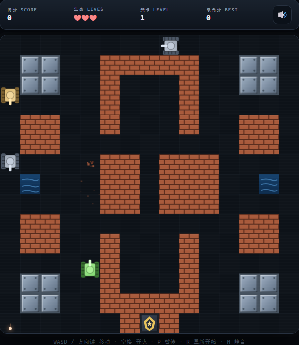

# 🎮 坦克大战 · Tank Battle

一个用原生 HTML5 Canvas 编写的复古坦克大战小游戏。零依赖、零构建，双击 `index.html` 就能玩。



## ✨ 特性

- **经典玩法**：守住基地，消灭来袭的敌方坦克
- **3 张手工设计地图**，关卡无限循环，难度逐关提升
- **3 种敌方坦克**：普通、快速、重甲（需要多次命中）
- **可交互地形**：砖墙可被击毁、钢墙坚不可摧、水域无法通行、树丛可藏身
- **完整特效**：粒子爆炸、屏幕震动、合成音效、受击闪白、无敌护盾
- **双端操作**：键盘 + 手机触屏虚拟按键
- **本地最高分**：使用 `localStorage` 记录

## 🕹 操作

| 动作 | 键盘 |
| --- | --- |
| 移动 | `WASD` / 方向键 |
| 开火 | `空格` |
| 暂停 | `P` |
| 重新开始 | `R` |
| 静音 | `M` |

手机 / 平板会自动显示方向键和圆形开火按钮。

## 📖 玩法

- 保护画面底部的金色基地，消灭所有敌方坦克即可过关
- 每关敌人数量为 `8 + 关卡 × 2`，同时在场数量与敌人强度会逐关提升
- 基地被击毁或生命耗尽，游戏结束
- 击毁普通 / 快速 / 重甲坦克分别获得 100 / 200 / 300 分

## 🚀 运行

直接双击 `index.html` 即可（不需要服务器）。

也可以启动一个本地静态服务器：

```bash
python -m http.server 8000
# 浏览器打开 http://localhost:8000
```

## 🗂 项目结构

```
.
├── index.html      # 页面结构、HUD 与触屏按键
├── style.css       # 街机风界面样式
├── game.js         # 游戏主循环、AI、碰撞与 Canvas 渲染
├── screenshot.png  # 游戏截图
└── README.md
```

## 🛠 技术说明

纯 HTML + CSS + 原生 JavaScript（Canvas 2D），无任何第三方依赖。

- `requestAnimationFrame` + 时间步长驱动的 60 FPS 主循环
- 基于瓦片地图的 AABB 碰撞检测，子弹采用子步进防止穿透
- 简单敌方 AI：追踪玩家 / 基地、遇墙换向、对齐后开火
- Web Audio API 实时合成射击、爆炸等音效
- 响应式布局，适配桌面与移动端

## 📄 说明

本项目仅供学习与娱乐使用。
